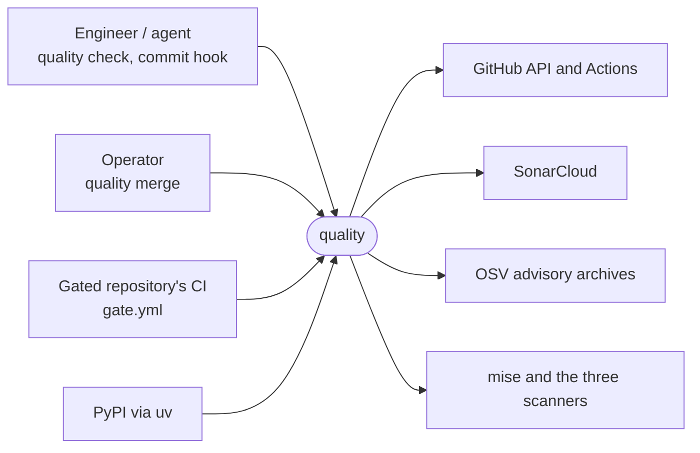
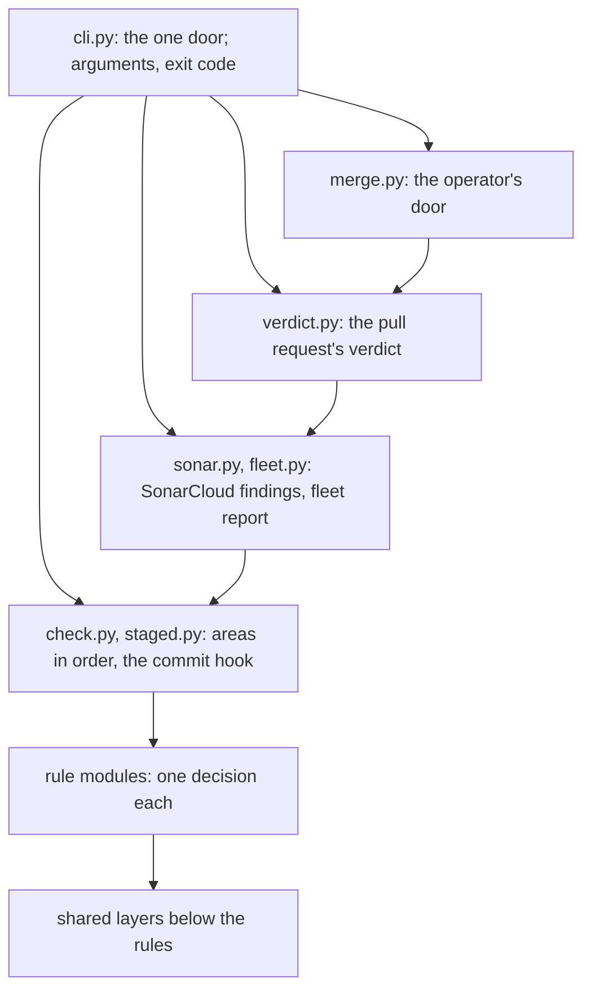

# quality architecture

For the engineer or agent about to change quality: the parts, who talks to whom, where the trust ends and why the
constraints stand. The references ([gate](gate.md), [codeql](codeql.md), [sonar](sonar.md), [rules](rules.md),
[commands](commands.md)) own the detail and are linked, never repeated.

## 1. Context and Scope

The engineer and the agent run `quality check` locally and in the commit hook. The operator uses his door
(`quality merge`) to merge past a red gate. Every gated repository's CI calls the reusable `gate.yml`, which
runs the check, the SonarCloud job and the verdict. Outside quality lie GitHub (its API and Actions), SonarCloud, the
OSV advisory archives, mise with the three scanners it installs, and PyPI, which uv installs quality's own dependencies
from.



## 2. Building Block View

One command line starts every job. The layers contract in `pyproject.toml` (`[tool.importlinter]`) owns the order of
the blocks, and `quality check` enforces it: a module imports only from the layers below its own.



Rules return findings and never print; `output.py` owns every printed line. `checkout.py` and `repository.py` are the
only readers of the checked-out files, `web.py` the only HTTP transport.

## 3. Runtime View

`quality check` is the core flow; the verdict in CI judges the finished jobs of a run and is described in
[the gate](gate.md).

```mermaid
sequenceDiagram
    participant Door as cli.py
    participant Check as check.py
    participant Rule as rule module
    participant Files as checkout.py, repository.py
    participant Scanner as scanner via process.py
    participant Output as output.py
    Door->>Check: named areas, or all
    loop each selected area, in Area's order
        Check->>Rule: judge the area's rules
        Rule->>Files: read tracked files inside the repository
        opt scanner rule
            Check->>Check: hold the live line up
            Rule->>Scanner: gitleaks, actionlint, osv-scanner via mise which; ruff, zizmor from quality's installation
            Scanner-->>Rule: exit and output
        end
        Rule-->>Check: findings or a refusal, as values
        Check->>Output: the finished area
    end
    Check-->>Door: the worst outcome
    Door->>Door: exit 0, 1 or 2
```

gitleaks, actionlint and osv-scanner are found with `mise which` in quality's manifest directory and run only at the
manifest's version. ruff and zizmor are dependencies of quality's package, found in its own installation at their pin.

## 4. Deployment View

A person installs quality with `uv tool install` from a tag ([README](../README.md#install)). A caller's CI runs the
reusable `gate.yml` at the tag it pins; its caller contract stands in [gate](gate.md), and that workflow checks out
quality and installs the three mise scanners from `src/quality/mise/`. `codeql.yml` is the reusable CodeQL workflow,
with its caller contract in [codeql](codeql.md), and `code-scanning.yml` quality's own caller of it. quality's CI runs
its suite with coverage and calls its local `gate.yml`. `scoreboard.yml` runs the fleet report weekly and writes to no
repository. `release.yml`, dispatched with a version, calls the reusable `release-gate.yml`, then builds and runs
`scripts/verify_release.py`; its tag job calls `release-tag.yml` and is the only job that writes
([release](release.md)). `image.yml` is the reusable image build an app's release calls; it pushes to GHCR and attests
([release](release.md)).

## 5. Crosscutting Concepts

**Trust.** The operator and his settings are trusted. A pull request's content and every repository text are untrusted
input: output masks them and stops workflow commands ([rules](rules.md), the output contract). Reads stay inside the
repository (`repository.py`). A scanner's stderr is shown only once gitleaks clears it. The GitHub transport follows no
redirect. The Sonar token's boundary stands in [sonar](sonar.md#quality-sonar-findings). The advisory archive is an
unsigned zip over TLS and is never cached ([rules](rules.md)). Agents are cooperative and share the operator's `gh`
login, so the door is the agreed path, not a lock; a real lock (a token without admin rights) belongs to the machine's
setup, not to quality.

**Proof strategy.** A test's kind, `unit` or `integration`, follows from the markers in `pyproject.toml`, and
`tests/conftest.py` fails a unit test that starts a process or opens a socket. A fake `mise` serves the scanners unless a
test is marked `scanner`. Workflow tests sit in `tests/workflows/`. CI runs the whole suite with coverage and the gate on
quality itself.

**Errors.** The exit contract is 0 clean, 1 findings, 2 cannot judge, 130 interrupted. Cannot judge is never clean, and a rule that cannot judge refuses only itself.

## 6. Constraints and reasons

- A loosening is declared and stays red; only the operator's door merges it. A pull request writes its own declaration,
  so the declaration alone proves nothing: an agent could write the declaration and the loosening in one pull request.
- Callers pin quality's workflows by commit with the tag in a comment, and Dependabot bumps them; quality's own action
  pins move the same way. One release then reaches every caller through a pull request it judges itself, with no token
  that writes to every repository.
- A repository turns SonarCloud off only in `quality/config.toml`: the verdict holds the config against the base, so switching it off is a loosening only the operator's door merges, which a workflow input would not be.
- One reusable CodeQL workflow serves the fleet and uploads under the Default Setup's category, so alerts carry over when
  a repository switches.

## 7. Not chosen

- The hosted SonarCloud gate alone instead of quality's own count: the hosted gate has no condition on new issues and
  SonarCloud backdates an issue raised on an unchanged line, so it cannot fail on one, and at the pinned scanner a
  properties file can still reach the token. Reopens when the hosted gate fails on such a finding and the pinned scanner
  no longer lets a properties file reach the token.
- Skipping the `sonar` job, by a job `if:` or by repository visibility: a job `if:` cannot read the config, so every scan would wait for its check and the verdict and the door would need a second meaning of `skipped`; visibility is no scanning intent and bypasses the config comparison. Reopens when a job `if:` can read the caller's files.
- A copier template or a token that writes to every repository: callers pin a tag that Dependabot bumps. Reopens when a
  caller needs a file that a reusable workflow cannot give it.
- One Sonar exception per exact `FROM` line, or a per-image entry: Sonar's own exception for `docker:S8431` checks only
  that `.github/dependabot.yml` exists. Reopens when Sonar's exception reads the file's content.
- CodeQL on private repositories: it needs GitHub Code Security, which the fleet does not pay for. Reopens when the
  operator buys it.

## 8. Risks and Technical Debt

- Agents share the operator's `gh` login; the door is a contract, not a lock.
- A defect in the shared gate reaches every gated repository at once, and so does its fix.
- SonarCloud's engine is downloaded unpinned, an accepted trust boundary ([sonar](sonar.md#quality-sonar-findings)).
- The size ceiling (`quality/baseline.toml`) lists the modules above the debt marks.
